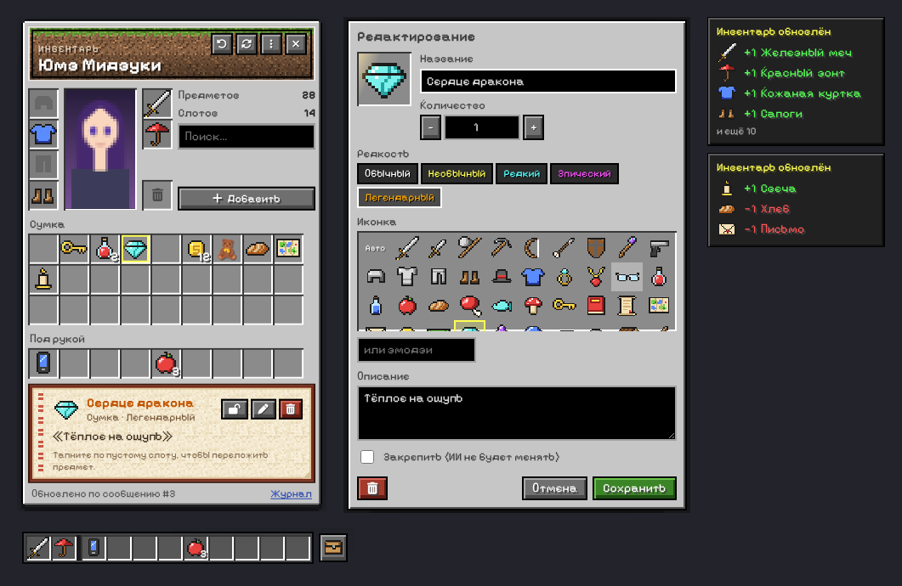

# Inventory UI для SillyTavern

Инвентарь в стиле Minecraft для [SillyTavern](https://github.com/SillyTavern/SillyTavern). Отдельная дешёвая модель после каждого сообщения ИИ смотрит, что персонажи подобрали, потратили, надели или отдали, и обновляет инвентарь. Затем расширение вставляет его в промпт основной модели, чтобы бот помнил, что у персонажей при себе.



*[English version below](#english)*

## Возможности

- **Окно инвентаря в стиле Minecraft.** Броня (голова, тело, ноги, обувь), правая и левая рука, пиксельный портрет персонажа, сумка 9×N, хотбар «под рукой», корзина, поиск, журнал изменений.
- **Drag-and-drop мышью и пальцем.** Перетаскивание между слотами, обмен местами, объединение одинаковых предметов в стак.
- **Своя модель для трекера.** Анализ идёт через профиль Connection Manager, так что основная модель не тратит на него токены. Если профиль не выбран, используется основной API, но в запрос уходит только короткий промпт без всего чата.
- **Память бота.** Инвентарь вставляется в промпт на выбранную глубину, и модель видит, что надето, что в руках, что под рукой и что лежит в сумке. Есть макрос `{{inventory}}`.
- **Свайпы, регенерации и удаления.** Каждое изменение трекера записывается в журнал и при свайпе или удалении сообщения откатывается. Ручные правки при этом сохраняются. При возврате к старому свайпу его результат применяется снова без нового запроса.
- **Ожидание перед генерацией.** Если вы отправите сообщение, пока трекер ещё работает, генерация подождёт его, чтобы бот получил актуальный инвентарь.
- **Несколько владельцев.** Можно вести инвентарь персонажа, персоны или обоих сразу, в группах — каждого участника. Предмет передаётся броском на вкладку другого персонажа.
- **57 пиксельных иконок** (меч, зелье, ключ, телефон, сигареты, зонт…) и эмодзи. Цвет названия зависит от редкости, у редких предметов есть анимированный «блеск зачарования».
- **Ручное редактирование.** Можно менять название, количество, иконку, редкость и описание. Закреплённый предмет 🔒 трекер не тронет.
- Хотбар над полем ввода, уведомления об изменениях, отмена (Ctrl+Z), экспорт и импорт JSON.
- Интерфейс на русском и английском, пиксельный шрифт с кириллицей (Pixelify Sans).

## Установка

1. В SillyTavern откройте **Extensions → Install extension**.
2. Вставьте ссылку на репозиторий: `https://github.com/jellysilly/ST-Inventory-UI`
3. Перезагрузите страницу. Окно открывается через меню-волшебную палочку (**Inventory UI**), хотбар над полем ввода или командой `/inventory`.

Проверено на SillyTavern 1.19.0. Отдельный профиль для трекера требует встроенного расширения **Connection Manager** (оно включено по умолчанию).

## Настройка модели-трекера

1. Подключитесь в SillyTavern к дешёвой и быстрой модели (например, Gemini Flash, DeepSeek, GPT-4o-mini или локальной).
2. В **Connection Manager** (иконка вилки на верхней панели) сохраните это подключение как профиль, например «Трекер».
3. Вернитесь на основную модель.
4. В **Extensions → Inventory UI** выберите профиль «Трекер» в поле *Профиль подключения для трекера*.

На вход трекеру уходят инструкция, текущий инвентарь и новые сообщения — обычно около 1–2 тыс. токенов, в зависимости от длины сообщений. Ответ — короткий JSON.

## Как пользоваться окном

| Действие | Как |
|---|---|
| Переложить предмет | перетащить в другой слот или тапнуть по предмету, затем по пустому слоту |
| Поменять местами / объединить стак | бросить на занятый слот (одинаковые предметы объединятся) |
| Разделить стак пополам | перетащить с зажатым Ctrl или Alt (или кнопка ✂ в редакторе) |
| Быстро переложить сумка ↔ хотбар | Shift + клик |
| Редактировать | двойной клик, правая кнопка мыши или долгое нажатие на телефоне |
| Добавить предмет в конкретный слот | правая кнопка мыши по пустому слоту |
| Передать другому персонажу | бросить предмет на его вкладку (или кнопка «Передать») |
| Удалить | бросить в корзину, кнопка 🗑 или клавиша Delete |
| Отменить | кнопка ↶ или Ctrl+Z |

Что означают слоты (так их видит и основная модель, и трекер):

- **Голова / Тело / Ноги / Обувь** — то, что надето.
- **Правая / левая рука** — то, что персонаж держит.
- **Под рукой** (хотбар) — карманы, пояс.
- **Сумка** — всё остальное, что персонаж несёт с собой.

Для уже идущего чата нажмите **⋮ → Собрать из истории**: трекер прочитает последние сообщения (по умолчанию 30) и описание персонажа и заполнит инвентарь.

## Макросы и команды

- `{{inventory}}` — текущий инвентарь текстом. Работает в карточке, заметке автора, лорбуке и других местах.
- `/inventory [open|close|toggle]` — открыть или закрыть окно.
- `/inventory-scan` — переанализировать последнее сообщение; `/inventory-scan history` — собрать инвентарь из истории.
- `/inventory-add qty=3 owner=Имя where=bag icon=apple rarity=rare desc=... Название` — добавить предмет.
- `/inventory-remove qty=1 owner=Имя Название` — убрать предмет или его часть.
- `/inventory-get [format=json]` — вернуть инвентарь (для STscript).

## Настройки

| Настройка | По умолчанию | Описание |
|---|---|---|
| Чей инвентарь | Персонаж | персонаж, персона или оба |
| Профиль подключения | основной API | модель, которая анализирует сообщения |
| Обновлять автоматически | вкл. | анализ после каждого сообщения ИИ |
| Анализировать каждые N сообщений | 1 | реже — дешевле |
| Ждать обновления перед генерацией | вкл. | чтобы бот всегда видел свежий инвентарь |
| Макс. новых сообщений / контекста | 4 / 1 | сколько сообщений уходит трекеру |
| Позиция / глубина / роль | в чате, 2, система | куда вставлять инвентарь |
| Шаблон инъекции | — | `{{inventory}}` заменяется списком |
| Промпт трекера | — | можно править; ответ должен быть JSON |
| Хотбар, уведомления, пиксельный шрифт, размер слотов | — | внешний вид |

Инвентарь хранится в метаданных чата, у каждого чата он свой. Ветка (branch) получает копию инвентаря, откаченную к сообщению, от которого она создана (в пределах последних 40 проанализированных сообщений).

## Разработка

```bash
node --test tests/logic.test.mjs
```

Структура:

- `index.js` — события SillyTavern, очередь трекера, откат по свайпам, инъекция, команды.
- `src/state.js` — модель данных, применение изменений, журнал для отката.
- `src/tracker.js` — промпт трекера, запрос через профиль, разбор JSON.
- `src/ui.js` — окно, drag-and-drop, редактор, хотбар, уведомления.
- `src/sprites.js` — пиксельные иконки 16×16.
- `src/textures.js` — процедурные текстуры (земля, трава, пергамент).

Шрифт [Pixelify Sans](https://github.com/eifetx/Pixelify-Sans) распространяется по лицензии SIL Open Font License 1.1 (`fonts/OFL.txt`).

---

<a id="english"></a>

## English

A Minecraft-style inventory for SillyTavern. After every AI message a separate, cheap model (any Connection Manager profile) reads the new messages and returns a JSON list of inventory changes. The inventory is shown in a draggable pixel-art window and injected into the main prompt, so the bot remembers what the characters actually carry.

- Armor, hand, hotbar and bag slots with drag-and-drop (mouse and touch), stacking, splitting and give-by-dropping-on-a-tab.
- A separate API profile for the tracker; the main API with a minimal prompt is the fallback.
- Swipes, regenerations, continues and deletions undo exactly what the tracker applied for that message. Cached swipes are re-applied without a new request.
- Generation waits for a running tracker update, so the injected inventory is always current.
- `{{inventory}}` macro, `/inventory`, `/inventory-scan`, `/inventory-add`, `/inventory-remove` and `/inventory-get` commands.
- 57 pixel icons plus emoji, rarity colors with enchantment glint, locked items the AI can't change, undo, JSON export and import, Russian and English UI.

**Install:** Extensions → Install extension → `https://github.com/jellysilly/ST-Inventory-UI`. Then save a cheap model as a Connection Manager profile and pick it in *Extensions → Inventory UI → Connection profile for the tracker*.
